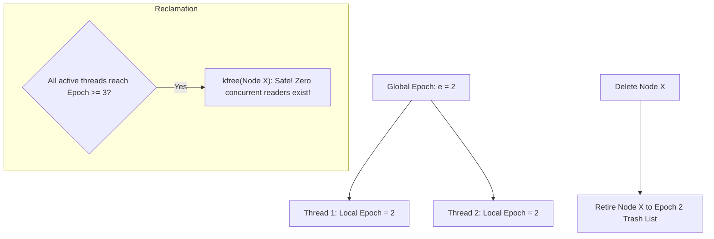

# Concurrency Internals: Epoch-Based Memory Reclamation (EBR)

In lock-free data structures (crossbeam, jemalloc), threads cannot free nodes immediately because concurrent readers may still hold pointers. EBR tracks generational epochs.

---

## 1. Overhead
EBR introduces near-zero overhead during active reads compared to atomic reference counting or Hazard Pointers.
