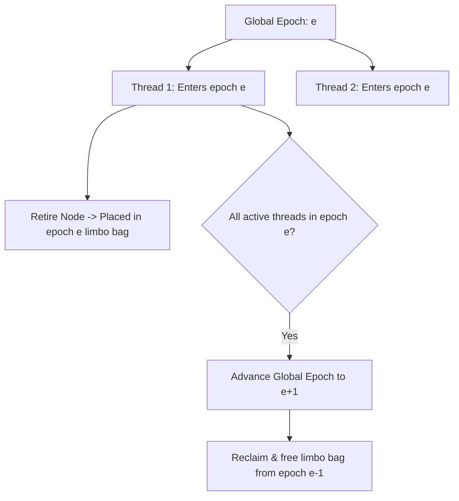

# Epoch-Based Reclamation (EBR) Architecture

EBR provides low-overhead memory reclamation for lock-free and read-copy-update (RCU) algorithms.

---

## 1. Epoch Cycles

- System maintains a global epoch counter ($e \in \{0, 1, 2\}$).
- Threads register upon entering a critical read section.
- Memory retired in epoch $e$ is guaranteed safe to delete once all threads have progressed past epoch $e$.
