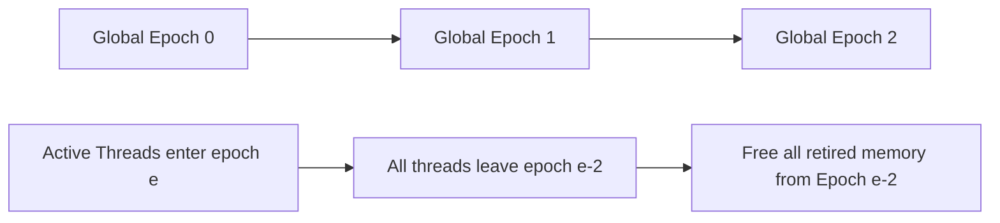

# Epoch-Based Reclamation & Userspace RCU

Epoch-Based Reclamation (EBR) aggregates memory deallocation into discrete global epochs, amortizing atomic synchronization costs across batches of objects.



---

## 1. Epoch Progression Rules

Global epoch $E$ advances from $0 \to 1 \to 2 \to 0$. Memory unlinked during epoch $E$ is guaranteed safe for physical deletion once all active threads have witnessed and transitioned to epoch $(E + 2) \pmod 3$.

---

## 2. Core EBR Implementation

```cpp
#include <atomic>
#include <vector>

class EpochReclaimer {
public:
    EpochReclaimer() : global_epoch_(0) {}

    void enter_critical_section(size_t thread_id) {
        active_epochs_[thread_id].store(global_epoch_.load(std::memory_order_relaxed), std::memory_order_seq_cst);
    }

    void leave_critical_section(size_t thread_id) {
        active_epochs_[thread_id].store(INACTIVE, std::memory_order_release);
    }

    void retire(void* ptr) {
        uint64_t current_epoch = global_epoch_.load(std::memory_order_relaxed);
        retired_limbo_[current_epoch % 3].push_back(ptr);
        try_advance_epoch();
    }

private:
    static constexpr uint64_t INACTIVE = UINT64_MAX;
    std::atomic<uint64_t> global_epoch_;
    std::atomic<uint64_t> active_epochs_[64];
    std::vector<void*> retired_limbo_[3];

    void try_advance_epoch() {
        // Verify all active threads are within current epoch before cycling
    }
};
```
