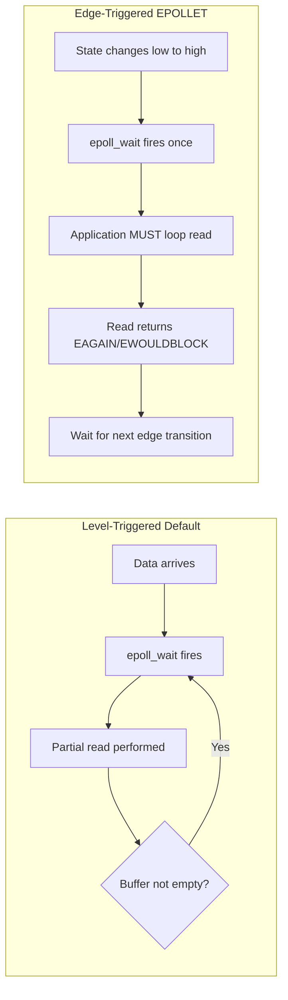

# Linux epoll: Level-Triggered vs Edge-Triggered Semantics

`epoll` is the scalable I/O event notification mechanism in Linux, operating with $O(1)$ complexity via kernel event queues.



---

## 1. Behavioral Differences

| Feature | Level-Triggered (`default`) | Edge-Triggered (`EPOLLET`) |
|---|---|---|
| **Notification Trigger** | Read/write readiness status (condition-based). | State transition from not-ready to ready (edge-based). |
| **Repeated Alerts** | Repeatedly returned by `epoll_wait` as long as buffer has unread bytes. | Returned once on state transition; silent until next new I/O event. |
| **Drain Requirement** | Can read arbitrary chunks and return to event loop. | Must read in a loop until `EAGAIN` or `EWOULDBLOCK`. |
| **File Descriptor Type** | Blocking or non-blocking. | **Must be non-blocking** (`O_NONBLOCK`). |
| **Risk** | High wake-up overhead. | Application hang if read loop terminates prematurely. |

---

## 2. Idiomatic Edge-Triggered Read Loop

```c
while (1) {
    ssize_t count = read(fd, buf, sizeof(buf));
    if (count == -1) {
        if (errno == EAGAIN || errno == EWOULDBLOCK) {
            break; // Drained completely
        }
        perror("read error");
        close(fd);
        break;
    } else if (count == 0) {
        close(fd); // Peer closed connection
        break;
    }
    process_data(buf, count);
}
```
