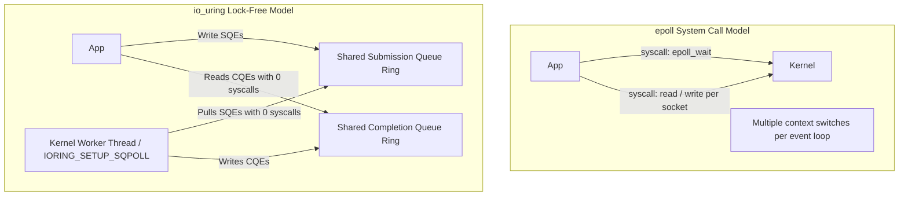

# Linux epoll vs. io_uring for Trading Gateways

While pinned matching cores avoid OS system calls, management and client gateways utilize Linux io_uring to submit batch network requests without context switches.

---

## 1. Feature Comparison

| Metric | Linux epoll | Linux io_uring (SQPOLL mode) |
|---|---|---|
| I/O Submission Method | Synchronous system calls (`write`, `sendto`) | Memory-mapped lock-free ring buffer |
| Context Switch Cost | 200–400 ns per `epoll_wait` + I/O call | **0 ns** (Worker kernel thread polls ring) |
| Buffer Registration | No (Buffer mapped/unmapped dynamically) | Fixed buffers (`IORING_REGISTER_BUFFERS`) |
| Scalability | Degrades past 10,000 active connections | Scales linearly via completion rings |
