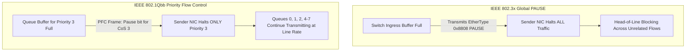

# High-Speed Ethernet: Flow Control & Priority Flow Control (PFC)

To achieve lossless transmission for RoCEv2 (RDMA over Converged Ethernet), switches and NICs manage congestion using Priority-Based Flow Control (IEEE 802.1Qbb).

---

## 1. Deadlock Mitigations

* **PFC Deadlock:** Cyclic dependencies across multi-hop switch fabrics can form PAUSE loops, halting traffic indefinitely.
* **Watchdog Timers:** Modern top-of-rack switches run PFC Watchdogs that monitor buffer queues; if a queue stays in a PAUSE state beyond threshold (e.g., $100\mu	ext{s}$), the switch drops packets to break the deadlock.
