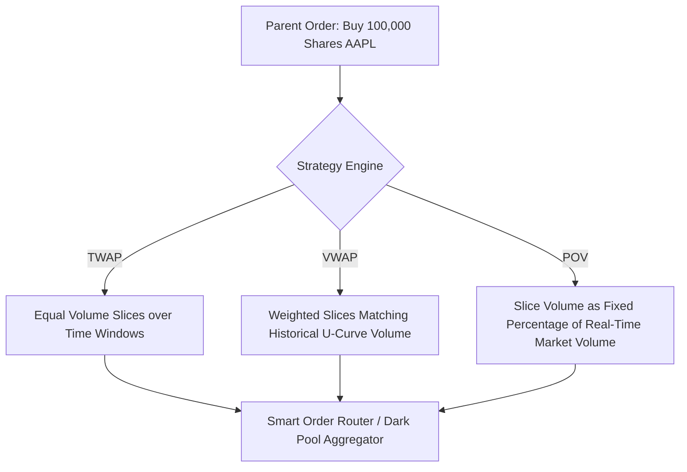

# Execution Algorithms: VWAP, TWAP & POV Architecture

Institutional execution algorithms slice large parent orders into child slices to minimize market impact, spread crossing costs, and adverse price drift.

---

## 1. Algorithm Characteristics

| Execution Algorithm | Schedule Basis | Risk Profile | Primary Metric Evaluated |
|---|---|---|---|
| **TWAP (Time-Weighted)** | Fixed uniform intervals | Higher tracking error during market open/close | Simple benchmark fill price |
| **VWAP (Volume-Weighted)** | Historical intra-day volume distribution curve | Low market impact during high-volume periods | Volume-weighted price difference |
| **POV (Percentage of Volume)** | Dynamic real-time market volume participation | Matches market liquidity rate dynamically | Slippage relative to arrival price |

---

## 2. Intra-Day U-Curve VWAP Target Formula

$$\text{TargetSliceQty}_i = \text{TotalOrderQty} \times \frac{\text{HistoricalVolume}_i}{\sum_{k=1}^N \text{HistoricalVolume}_k}$$
