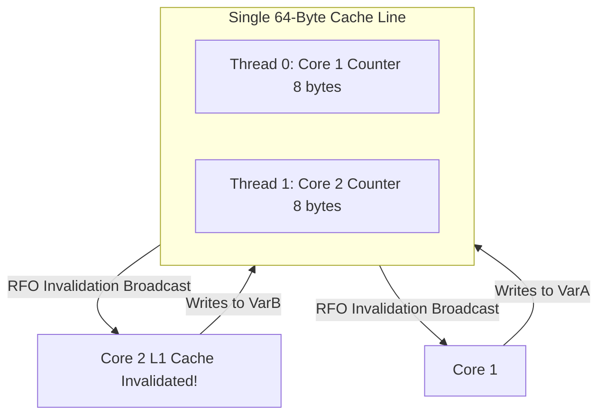

# False Sharing & Cache Line Bouncing Elimination

False sharing occurs when independent variables accessed by different CPU cores reside on the same 64-byte cache line, causing unnecessary cache invalidations.



---

## 1. Profiling with Linux `perf c2c`

Cache-to-cache (c2c) bouncing can be diagnosed via Linux performance monitoring counters:

```bash
# Record cache line bouncing events
sudo perf c2c record -F 60000 -- ./matching_engine

# Generate analysis report
sudo perf c2c report --stdio
```

Look for `HITM` (Hit in Modified cache line), indicating that a core had to service a read directly from another core's dirty L1/L2 cache over the interconnect.

---

## 2. Alignment Remediation in C++

```cpp
#include <cstdint>
#include <new>

// Vulnerable to false sharing: both counters sit on the same 64-byte line
struct UnpaddedCounters {
    uint64_t core1_processed;
    uint64_t core2_processed;
};

// Protected against false sharing: each counter occupies its own cache line
struct alignas(64) PaddedCounters {
    alignas(64) uint64_t core1_processed;
    alignas(64) uint64_t core2_processed;
};
```
