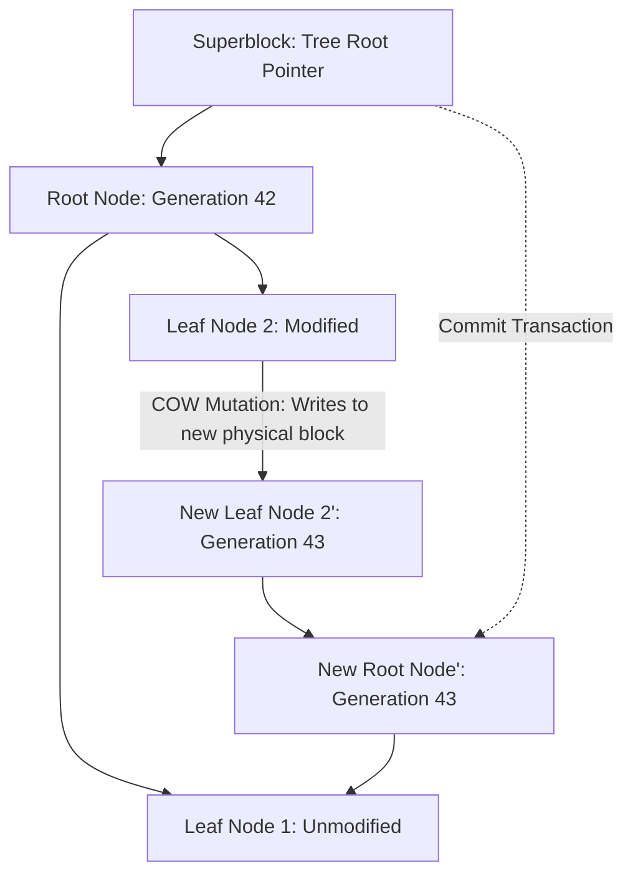

# File Systems: Btrfs Copy-on-Write (COW) & Extent Trees

Btrfs enforces Copy-on-Write across all file data and tree metadata, allocating new disk blocks for modifications and updating parent references up to the Superblock root pointer.

---

## 1. Tree Hierarchy & Extent References

1. **Subvolume Snapshots:** Creating a snapshot duplicates only the root pointer; existing data and metadata blocks are shared read-only via 64-bit extent reference counters.
2. **Extent Tree:** Records block allocations, reference counts, and generation numbers, tracking when an extent reaches zero references for background space reclamation.
3. **Atomic Commits:** Modifications remain uncommitted until updated roots are flushed to physical disk and the Superblock generation pointer is updated.
