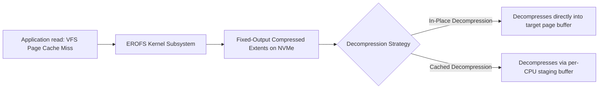

# Linux Storage: EROFS (Enhanced Read-Only File System)

EROFS provides high-performance, space-efficient read-only storage for container images and embedded Android systems using fixed-output block compression (LZ4 / MicroLZMA).

---

## 1. Fixed-Output Compression Advantage

* **Traditional Fixed-Input (e.g. SquashFS):** Compresses fixed blocks (e.g., 128KB) into variable-sized output, requiring variable reads and multi-page memory allocations during random access.
* **Fixed-Output (EROFS):** Compresses variable input into exact 4KB hardware page-aligned blocks; random reads access strictly the targeted 4KB block without reading adjacent blocks.
* **In-Place Decompression (IPD):** If uncompressed data fits within the allocated page range, decompression writes directly to user memory without temporary kernel heap buffers.
