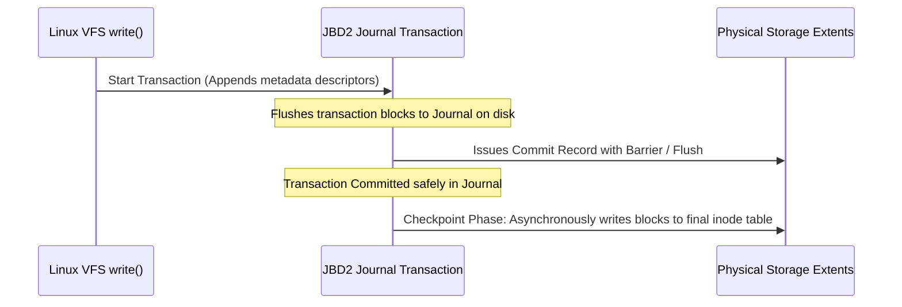

# File Systems: ext4 Journaling Block Device (JBD2) Architecture

The Journaling Block Device 2 (JBD2) protects ext4 file systems against power loss and system crashes by writing metadata modifications to a circular journal partition before committing blocks to disk.

---

## 1. Journaling Modes

| Mode | Mount Option | Data Invariant | Performance |
|---|---|---|---|
| **Data Journaling** | `data=journal` | Both user data and metadata pass through the journal | Lowest write throughput; maximum crash consistency |
| **Ordered** (Default) | `data=ordered` | User data is flushed to disk before metadata commits | High throughput; prevents stale file data leaks |
| **Writeback** | `data=writeback` | Metadata journals; user data writes proceed asynchronously | Highest throughput; potential stale data exposed after crash |
