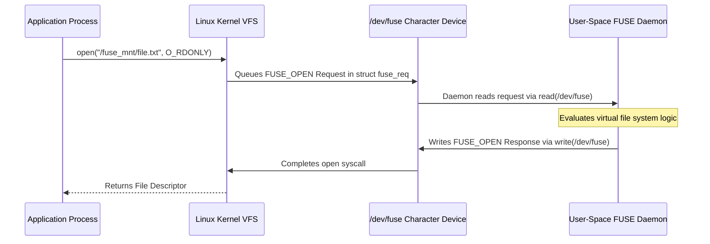

# Linux File Systems: FUSE (Filesystem in Userspace) Kernel Protocol

The FUSE kernel module proxies VFS file system operations across the `/dev/fuse` character device to user-space daemon processes, balancing developer flexibility against IPC boundary costs.

---

## 1. Performance Optimizations

* **Zero-Copy Splicing:** FUSE leverages `splice()` to stream data directly between `/dev/fuse` and target file descriptors without copying buffers through user memory.
* **Direct I/O (`FOPEN_DIRECT_IO`):** Bypasses kernel page cache for applications requiring custom caching logic.
* **`passthrough` Mode (Linux 6.9+):** Allows FUSE daemons to bind open files directly to underlying backer storage files, routing subsequent read/write calls at bare-metal native kernel speed.
