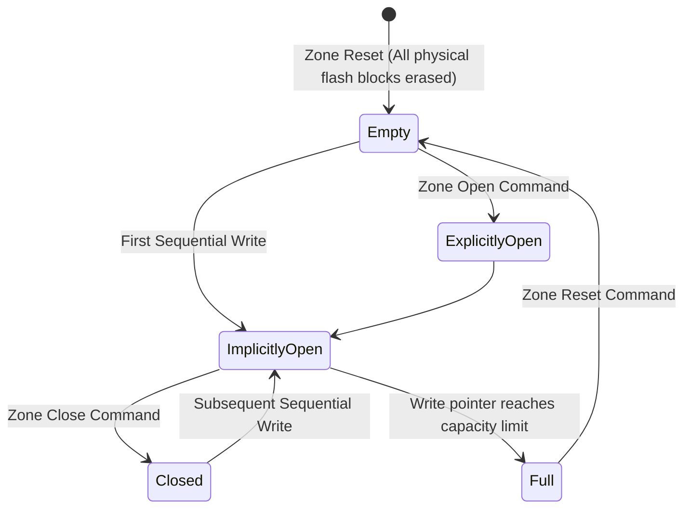

# Storage Systems: NVMe Zoned Namespaces (ZNS) Architecture

NVMe Zoned Namespaces (ZNS) eliminate SSD Flash Translation Layer (FTL) over-provisioning and garbage collection overhead by mandating sequential writes into fixed-size hardware zones.

---

## 1. Key Invariants & Host Software Roles

* **Write Pointer (WP):** Data must be written sequentially at the exact boundary of the zone's Write Pointer; random overwrite attempts return an I/O error.
* **Zero FTL Over-Provisioning:** The host file system (e.g., F2FS, Btrfs ZNS) manages wear leveling and garbage collection directly, reducing DRAM requirements inside SSD controllers.
* **Zone Append Command:** Hardware accepts append commands without specifying logical block addresses, returning the assigned LBA upon completion and enabling lockless concurrent writes.
