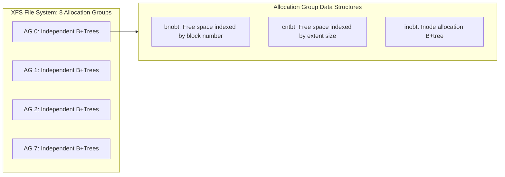

# File Systems: XFS Allocation Groups (AG) & Concurrency Architecture

XFS scales multi-threaded write performance on enterprise NVMe arrays by partitioning file systems into independent Allocation Groups (AG), each maintaining dedicated B+tree allocators.

---

## 1. Concurrency & Allocation Mechanics

* **Parallel Allocation:** Threads allocating blocks in disjoint Allocation Groups acquire separate AG header locks, eliminating global allocator serialization.
* **Dual Free Space B+Trees:**
  - `bnobt`: Enables fast coalescing of neighboring free extents.
  - `cntbt`: Enables $O(\log N)$ lookups for best-fit contiguous extent allocations.
* **Delayed Allocation (Delalloc):** Buffers allocation decisions until writeback, optimizing contiguous block placement and mitigating file fragmentation.
