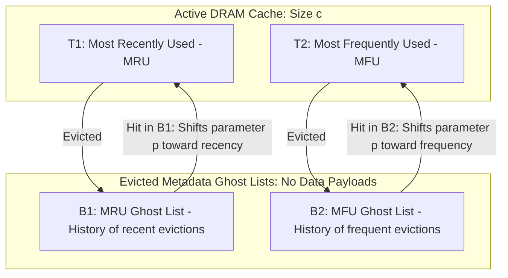

# File Systems: ZFS Adaptive Replacement Cache (ARC) & L2ARC

The ZFS Adaptive Replacement Cache (ARC) balances recency and frequency caching using four dynamic doubly linked lists and a self-tuning target size parameter $p$.

---

## 1. Tuning Mechanics

* **Target Adaptation ($p$):**
  - Hit in $B_1$: $p \leftarrow \min(p + \max(1, |B_2| / |B_1|), c)$
  - Hit in $B_2$: $p \leftarrow \max(p - \max(1, |B_1| / |B_2|), 0)$
* **Ghost Entries:** Contain only 64-bit ZFS block pointers (DVA), consuming negligible memory while preserving access history to guide eviction heuristics.
* **L2ARC (SSD Cache):** Background feed threads write evicted $T_1/T_2$ buffers sequentially to NVMe/SSDs without stalling synchronous read pipelines.
