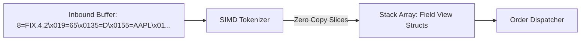

# Zero-Allocation FIX Protocol Parsing Architecture

Financial Information eXchange (FIX) text protocols require parsing tag-value pairs without heap allocations or string copying in the critical tick-to-trade path.



---

## 1. FIX Message Wire Format

FIX messages delimit tag-value pairs with ASCII `0x01` (`SOH`):

```text
8=FIX.4.2<SOH>9=78<SOH>35=D<SOH>49=CLIENT<SOH>56=EXCHANGE<SOH>34=101<SOH>55=MSFT<SOH>54=1<SOH>38=100<SOH>44=420.50<SOH>10=182<SOH>
```

---

## 2. In-Place Field Indexer

```cpp
#include <cstdint>
#include <string_view>

struct FixFieldView {
    uint32_t tag;
    std::string_view value;
};

class FastFixParser {
public:
    static constexpr size_t MAX_FIELDS = 64;

    size_t parse(const char* buf, size_t len, FixFieldView* fields) {
        size_t field_count = 0;
        const char* ptr = buf;
        const char* end = buf + len;

        while (ptr < end && field_count < MAX_FIELDS) {
            uint32_t tag = 0;
            while (*ptr >= '0' && *ptr <= '9') {
                tag = tag * 10 + (*ptr - '0');
                ptr++;
            }
            if (*ptr != '=') break;
            ptr++; // Skip '='

            const char* val_start = ptr;
            while (ptr < end && *ptr != '') {
                ptr++;
            }

            fields[field_count++] = {tag, std::string_view(val_start, ptr - val_start)};
            if (ptr < end && *ptr == '') ptr++;
        }
        return field_count;
    }
};
```
