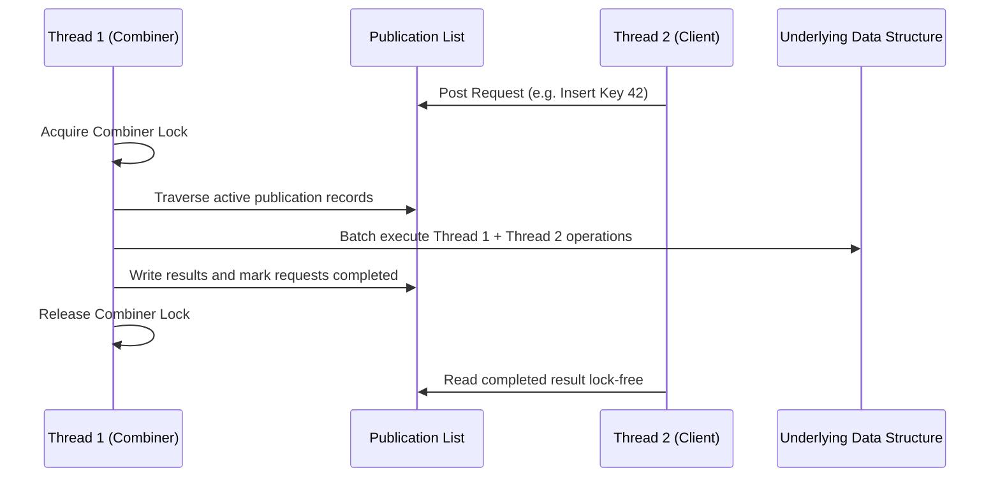

# Flat Combining Concurrent Synchronization Architecture

Flat Combining replaces high-contention fine-grained locking by allowing a single thread (the combiner) to collect, execute, and respond to operation requests posted by other concurrent threads into published thread-local publication slots.

---

## 1. Throughput Invariants

Under heavy concurrency, batching operations preserves CPU L1/L2 data cache locality inside the combiner core, avoiding cache line invalidation storms across inter-socket UPI interconnects.
