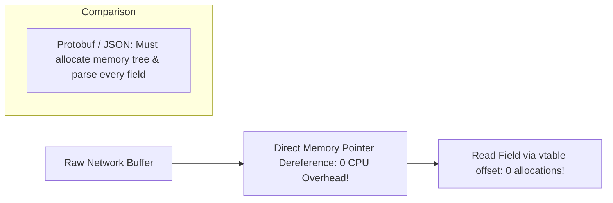

# High-Performance Serialization: Google FlatBuffers Zero-Copy Architecture

FlatBuffers allows access to serialized data without parsing or unpacking: the on-wire representation matches the memory representation.

---

## 1. Memory Efficiency
- Zero memory allocations on read path.
- Ideal for low-latency gaming, machine learning tensor transfer, and autonomous vehicles.
