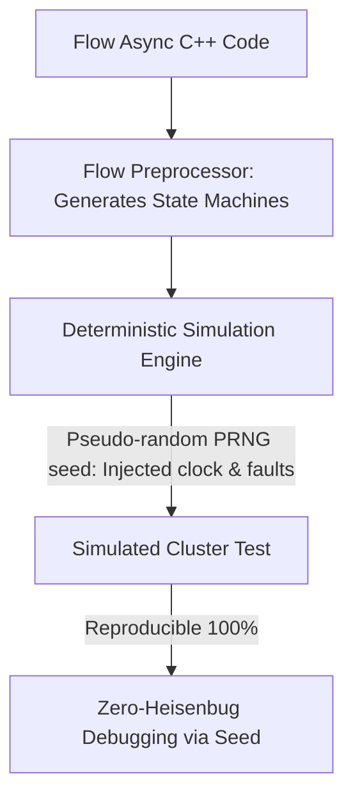

# FoundationDB: Flow Actor Framework & Simulation Testing

FoundationDB combines an asynchronous C++ actor framework (Flow) with deterministic simulation testing to inject network partitions, disk corruptions, and race conditions before production deployment.

---

## 1. Deterministic Simulation Invariants

1. **Deterministic Time & Network:** System clock and socket APIs route through a central event simulator seeded by a single 64-bit integer.
2. **Fault Injection:** The simulator dynamically drops packets, kills processes, delays disks, and swaps leaders during live transactions.
3. **Bug Replay:** Any failure discovered during test runs reproduces deterministically by re-running the test with the identical PRNG seed.
