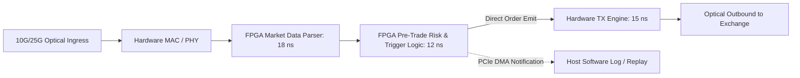

# FPGA-NIC Co-Processing & Bump-in-the-Wire Architecture

FPGA-accelerated SmartNICs parse market data ticks in silicon and transmit orders via bump-in-the-wire logic in under 50 nanoseconds.

---

## 1. Tick-to-Trade Latency Breakdown

| Subsystem Component | Software (Optimized C++) | FPGA Bump-in-the-Wire |
|---|---|---|
| Optical PHY Ingress | ~12 ns | ~12 ns |
| Packet Parsing & Deserialization | 80 ns – 200 ns | 15 ns – 25 ns |
| Price Comparison & Trading Decision | 50 ns – 150 ns | 10 ns – 20 ns |
| Outbound Order Serialization | 60 ns – 150 ns | 12 ns – 18 ns |
| PCIe Transfer to NIC | 250 ns – 450 ns | **0 ns** (Executed directly on NIC) |
| **Total Tick-to-Trade** | **452 ns – 962 ns** | **49 ns – 75 ns** |
