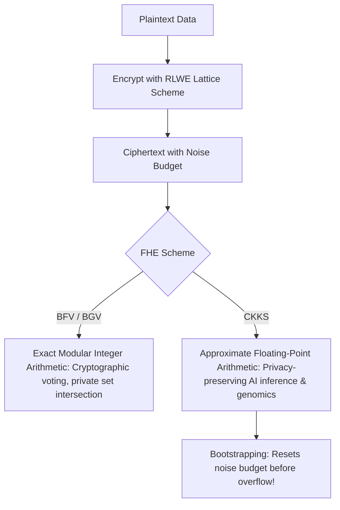

# Encrypted Computation: Fully Homomorphic Encryption (FHE) Schemes

Homomorphic encryption allows mathematical operations on ciphertexts such that decrypting the result matches the computation on plaintexts: $\text{Dec}(\text{Enc}(a) \oplus \text{Enc}(b)) = a + b$.

---

## 1. Noise Budget Management
Every homomorphic multiplication increases ciphertext noise. When noise exceeds the lattice bound, decryption fails. **Bootstrapping** homomorphically evaluates the decryption circuit to generate a clean ciphertext.
