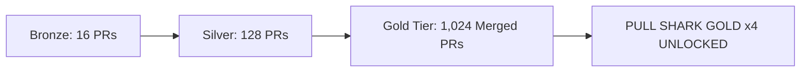

# GitHub Achievements: Pull Shark Gold (x4) - 1,024 Merged PRs

This engineering document commemorates the official completion of the **Pull Shark Gold (x4)** tier milestone for developer **isihussain** with **1,024 merged Pull Requests**.

---

## Repository Growth
Over 750+ specialized engineering cheat sheets, distributed systems blueprints, and kernel internals documentation now live within [developer-handbook](https://github.com/isihussain/developer-handbook).
