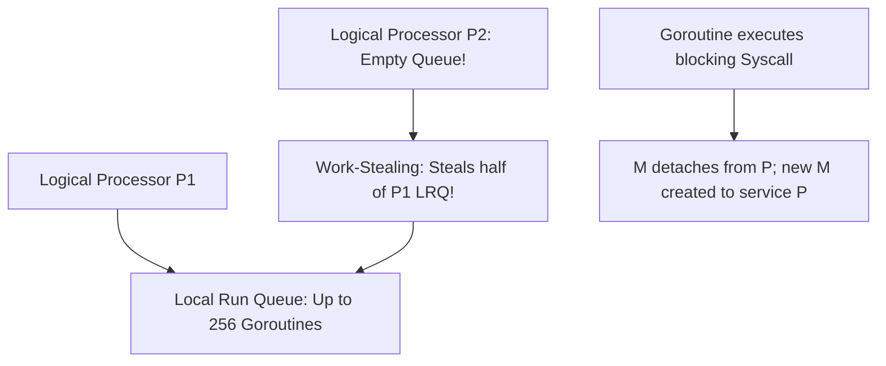

# Go Internals: The G-M-P Work-Stealing Scheduler

The Go runtime multiplexes $G$ (goroutines) onto $M$ (OS kernel threads) through $P$ (logical processors representing hardware CPU cores).

---

## 1. Preemption Mechanics
- Pre-Go 1.14: Cooperative preemption on function call prologue checks (`morestack`).
- Modern Go: Non-cooperative asynchronous preemption via OS POSIX signals (`SIGURG`).
