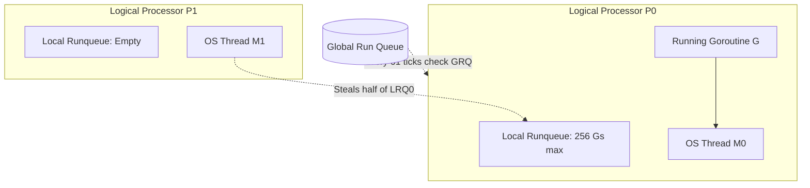

# Go Runtime M:N Work-Stealing Scheduler Architecture

The Go runtime orchestrates $N$ user-level goroutines ($G$) onto $M$ operating system threads through $P$ logical processors, balancing workloads using lock-free local runqueues and random victim work-stealing.

---

## 1. Work-Stealing Algorithm

1. Check local runqueue `P.runq` (lock-free ring buffer).
2. Every 61 ticks, poll global runqueue `sched.runq` to prevent starvation.
3. Check network poller (`netpoll`) for unblocked I/O events.
4. Pick random processor $P_{	ext{victim}}$ and steal $\lfloor N / 2 
floor$ goroutines from its local queue.
