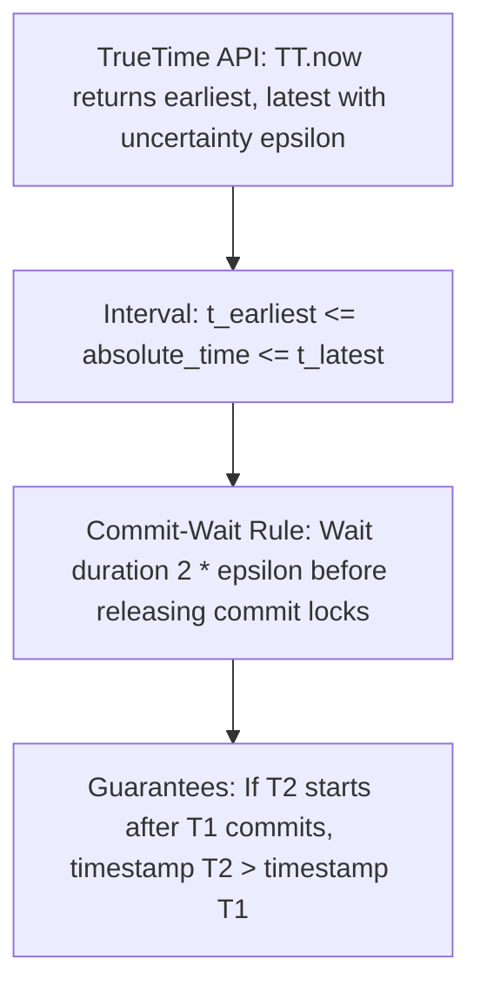

# Google Spanner TrueTime & Commit-Wait Protocol Architecture

Google Spanner achieves global external consistency (serializability across geo-distributed datacenters) by bounding physical time uncertainty using GPS receivers and atomic clocks.

---

## 1. Commit-Wait Invariant

1. Coordinator picks commit timestamp $s = 	ext{TT.now().latest}$.
2. Coordinator delays releasing locks until $	ext{TT.now().earliest} > s$.
3. Guarantees no subsequent transaction across the globe can be assigned a timestamp $\le s$.
