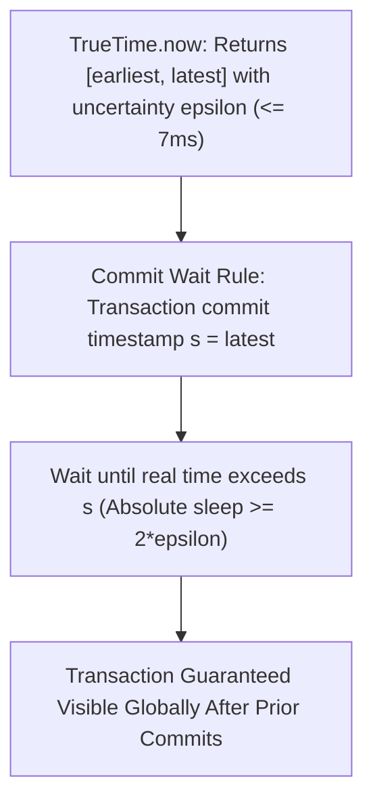

# Google Spanner: TrueTime & External Consistency Architecture

Google Spanner achieves global linearizable transactions (external consistency) without coordination locks by bounding physical clock drift using GPS and atomic clocks.

---

## 1. Key Invariants

1. **Clock Uncertainty ($\epsilon$):** Time API returns an interval $[t.earliest, t.latest]$ where $t.latest - t.earliest = 2\epsilon$.
2. **Commit Wait Principle:** The coordinator assigns a commit timestamp $s = \text{now}().latest$, then delays releasing locks until $\text{now}().earliest > s$.
3. **Lock-Free Read-Only Transactions:** Read queries require zero locks. They read point-in-time data from snapshot MVCC engines across global replicas without coordination overhead.
