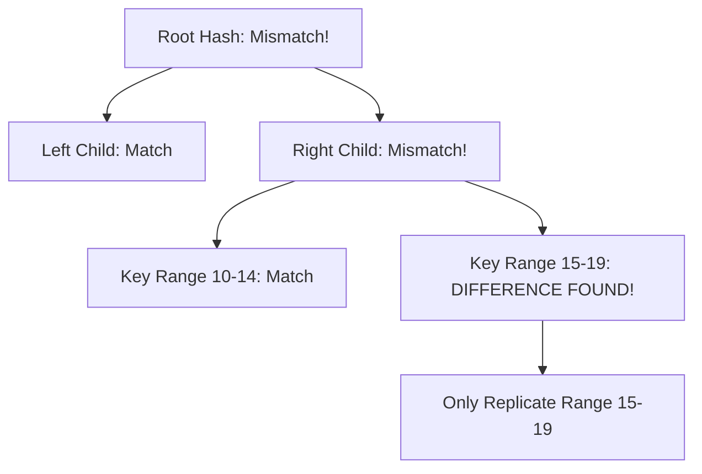

# Distributed Storage: Gossip Protocol Anti-Entropy with Merkle Trees

To synchronize divergent data across nodes with minimal network bandwidth, systems like Cassandra and Dynamo build hierarchical Merkle trees over hash ranges.

---

## 1. Algorithmic Complexity
- Tree comparison cost: $O(\log N)$ round-trips to isolate the exact corrupted range.
- Network payload: Proportional to the number of conflicting keys, not total dataset size.
