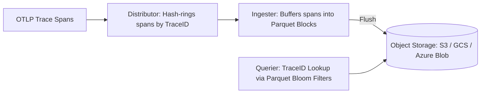

# Distributed Tracing: Grafana Tempo and Parquet Storage

Grafana Tempo delivers massive trace ingestion at low cost by eliminating distributed search indexes (Elasticsearch/Cassandra) in favor of object storage (S3/GCS) with Apache Parquet.

---

## 1. Cost Efficiency
Relying entirely on commodity object storage reduces total cost of ownership by up to 80% compared to traditional indexed trace backends.
