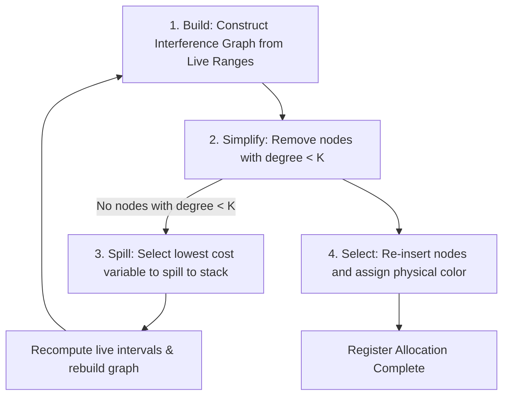

# Chaitin-Briggs Graph Coloring Register Allocation

Register allocation models virtual register live ranges as an undirected interference graph, mapping variables to $K$ physical registers by reducing the problem to NP-complete $K$-graph coloring.

---

## 1. Kempe's Heuristic

If a node $v$ has fewer than $K$ neighbors ($\deg(v) < K$), removing $v$ from the graph leaves a subgraph that is $K$-colorable if and only if the original graph is $K$-colorable.
