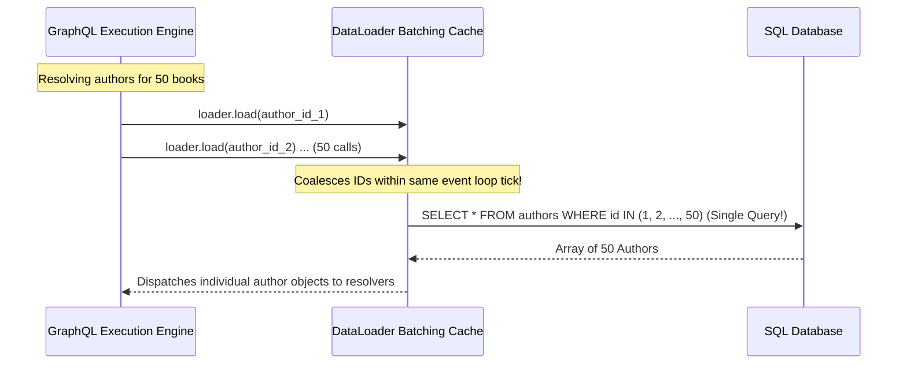

# API Optimization: GraphQL N+1 Query Problem & DataLoader Solution

Naive GraphQL resolvers execute individual database queries for each item in a parent collection, resulting in $N + 1$ database round-trips.

---

## 1. Event Loop Coalescing
DataLoader uses Node.js `process.nextTick()` or Python `asyncio` ticks to collect all keys requested in the current tick before firing the batch database fetch.
