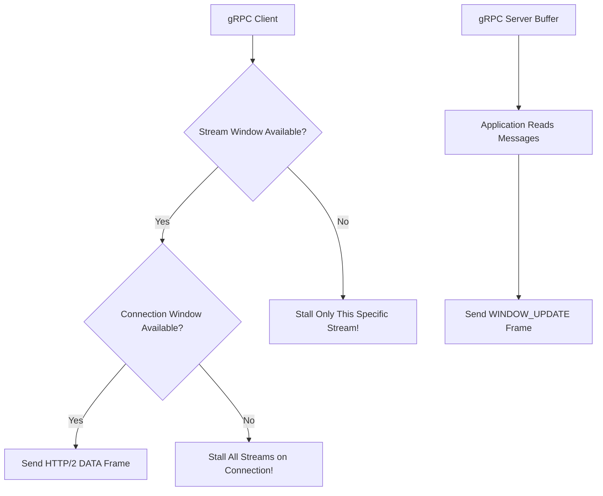

# RPC Networking: gRPC HTTP/2 Flow Control Windows

HTTP/2 uses window updates (`WINDOW_UPDATE` frames) at both the individual stream level and the global connection level to prevent fast senders from exhausting receiver buffers.

---

## 1. Head-Of-Line Blocking Mitigation
A stalled stream with a full window does not block other independent streams on the shared TCP connection.
