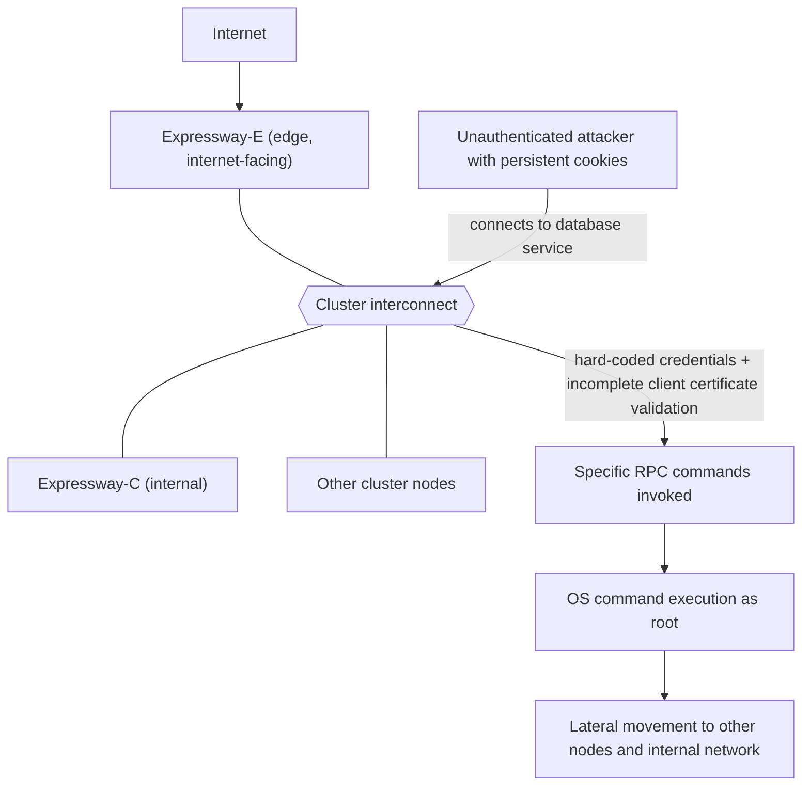

# Network Appliance Security: Hard-Coded Credentials & Cluster Trust Failures (Cisco Expressway CVE-2026-76466)

CVE-2026-76466 (CVSS 9.8) affects Cisco Expressway-C and Expressway-E devices **configured in a cluster**. Cisco patched it in October 2026; CISA added it to the KEV catalog on 2026-11-20 after in-the-wild exploitation was reported. It is a clean case study of how **inter-node trust paths** become the weakest link of an otherwise perimeter-hardened appliance.

---

## 1. Failure Model

---

## 2. What Went Wrong

| Layer | Expected control | Observed weakness |
| :--- | :--- | :--- |
| **Credential management** | Per-device, generated secrets | Use of hard-coded credentials |
| **Transport identity** | Full mutual-TLS validation of the connecting peer | Client certificates not fully validated |
| **Service exposure** | Cluster database service reachable only by cluster members | Reachable by a remote party with network access |
| **Privilege** | Service runs with least privilege | RPC commands result in command execution as **root** |

Reported by Cisco as exploitable by an unauthenticated, remote attacker who possesses persistent cookies and has network access.

---

## 3. Observed Post-Exploitation (F6 report)

* Initial compromise of two internet-facing Expressway devices.
* Pivot through them to two further cluster nodes on the internal network.
* Custom Python tooling for network scanning, SMB discovery, interaction with SQL Server and WinRM, and exploration of GitLab repositories to harvest credentials.
* F6 reported the attackers used an unnamed AI assistant to carry out the exploitation.

Takeaway: an edge collaboration gateway is a **pivot point** into the internal network, so compromise should be treated as network-wide compromise.

---

## 4. Defensive Checklist

* **Patch** to the fixed Cisco Expressway release (October 2026 advisory).
* **Restrict the cluster interconnect** to a dedicated management segment; cluster/database ports must not be reachable from untrusted networks.
* **Assume breach for exposed units.** CISA lists forensic triage as part of the BOD 26-04 flow; check for compromise before the patch date, not only after.
* **Rotate** credentials, keys and certificates that were stored on or reachable from affected nodes (including those usable from GitLab/SQL Server/SMB reachable by the device).
* **Egress and east-west monitoring** from collaboration gateways: alert on SMB, WinRM and SQL traffic originating from them.
* **Inventory exposure.** Censys observed roughly 14,900 internet-exposed Expressway hosts at the time of the report.

---

## 5. Design Lessons for Vendors and Platform Teams

| Anti-pattern | Safer pattern |
| :--- | :--- |
| Shared static credential baked into firmware | Per-device secret provisioned at first boot, stored in hardware-backed storage where available |
| TLS client cert "present" check | Full chain, validity, revocation and identity (SAN/CN) binding to an enrolled node |
| Cluster RPC reachable on all interfaces | Bind to the cluster interface only, firewall by default |
| Management services as root | Drop privileges, use capability-limited service accounts |

---

## References

* CISA KEV alert, 2026-11-20
* BleepingComputer, "CISA flags critical Cisco RCE flaw as actively exploited in attacks", 2026-11-23
* The Hacker News, 2026-11-21
