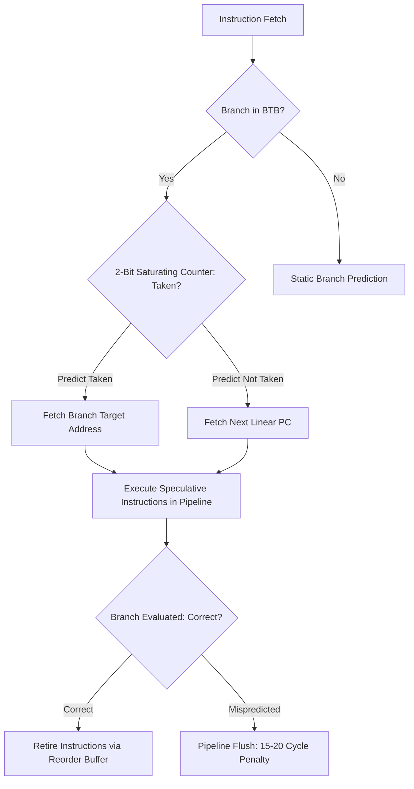

# Hardware Branch Prediction & Speculative Execution

Modern superscalar processors maintain deep 14 to 20-stage pipelines, relying on Branch Target Buffers (BTB) and Pattern History Tables (PHT) to predict control flow.



---

## 1. Branch Misprediction Penalties

A branch misprediction clears the entire Out-of-Order (OoO) execution window, discarding instructions in the Reorder Buffer (ROB) and resetting register alias tables:

$$\text{Penalty} \approx 15 \text{ to } 22 \text{ clock cycles} \approx 3.5 \text{ to } 5.5 \text{ ns on a 4.5 GHz core}$$

---

## 2. Branchless Programming Techniques

Replace unpredictable conditional jumps with conditional move (`cmov`) and bitwise operations:

```cpp
// Branching (Unpredictable market direction causes pipeline stalls)
int64_t calculate_fill(int64_t order_qty, int64_t book_qty) {
    if (order_qty < book_qty) {
        return order_qty;
    } else {
        return book_qty;
    }
}

// Branchless (Compiles directly to cmovg / cmovl assembly instructions)
int64_t calculate_fill_branchless(int64_t order_qty, int64_t book_qty) {
    return order_qty < book_qty ? order_qty : book_qty;
}
```
