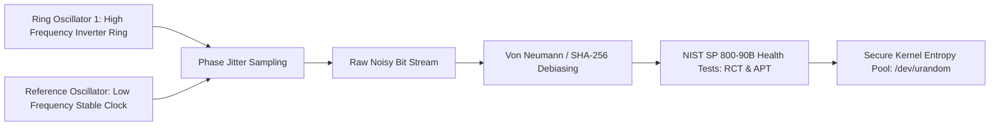

# Hardware Security: True Random Number Generators (TRNG) & Phase Jitter

Hardware True Random Number Generators (TRNG) derive unguessable cryptographic entropy by harvesting physical thermal noise and phase jitter from free-running digital ring oscillators.

---

## 1. Debiasing & Health Tests

* **Von Neumann Extractor:** Eliminates bias (asymmetric $0/1$ distribution) by inspecting consecutive non-overlapping bit pairs:
  - `01` $	o$ outputs `0`
  - `10` $	o$ outputs `1`
  - `00` or `11` $	o$ discarded
* **NIST SP 800-90B Online Tests:**
  - **Repetition Count Test (RCT):** Triggers error if identical output values repeat continuously past a threshold.
  - **Adaptive Proportion Test (APT):** Detects localized statistical deviations within sliding observation windows.
