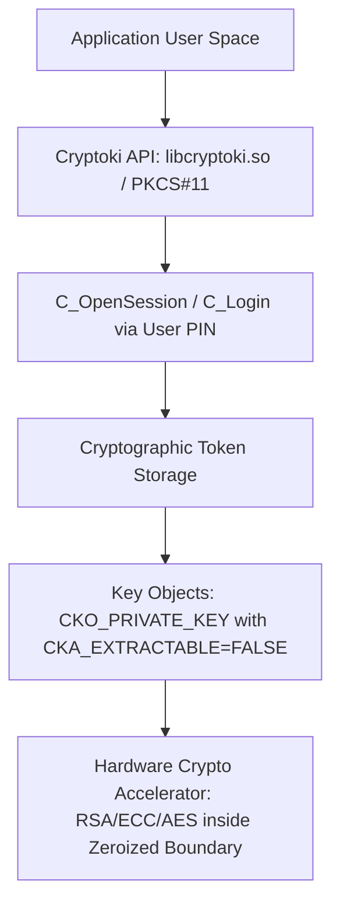

# Hardware Security Modules (HSM) & PKCS#11 Architecture

HSMs provide tamper-resistant cryptographic key generation, storage, and acceleration complying with FIPS 140-2/3 Level 3/4 physical envelope security.

---

## 1. Key PKCS#11 Attribute Constraints

| Attribute | Recommended Setting | Security Guarantee |
|---|---|---|
| `CKA_TOKEN` | `CK_TRUE` | Persists in non-volatile secure storage across session restarts. |
| `CKA_PRIVATE` | `CK_TRUE` | Requires authenticated `C_Login` session to access. |
| `CKA_EXTRACTABLE` | `CK_FALSE` | Private key bytes can **never** be exported in plaintext outside the HSM boundary. |
| `CKA_SENSITIVE` | `CK_TRUE` | Prohibits reading plaintext key material via `C_GetAttributeValue`. |
| `CKA_SIGN` | `CK_TRUE` | Enables cryptographic digital signature generation. |
