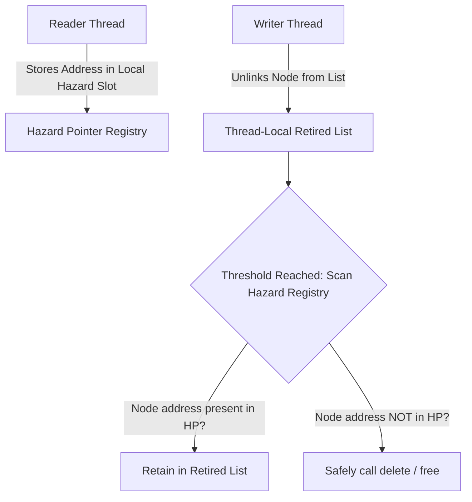

# Hazard Pointers for Lock-Free Memory Reclamation

Hazard pointers allow reader threads to safely access dynamically allocated objects in lock-free data structures without preventing concurrent reclamation by writer threads.



---

## 1. Reader Protocol

```cpp
#include <atomic>

template <typename T>
class HazardPointerManager {
public:
    static constexpr size_t MAX_THREADS = 64;

    T* acquire(size_t thread_id, std::atomic<T*>& target) {
        T* ptr;
        do {
            ptr = target.load(std::memory_order_relaxed);
            hazard_slots_[thread_id].store(ptr, std::memory_order_seq_cst);
        } while (ptr != target.load(std::memory_order_seq_cst));
        return ptr;
    }

    void release(size_t thread_id) {
        hazard_slots_[thread_id].store(nullptr, std::memory_order_release);
    }

private:
    std::atomic<T*> hazard_slots_[MAX_THREADS];
};
```
