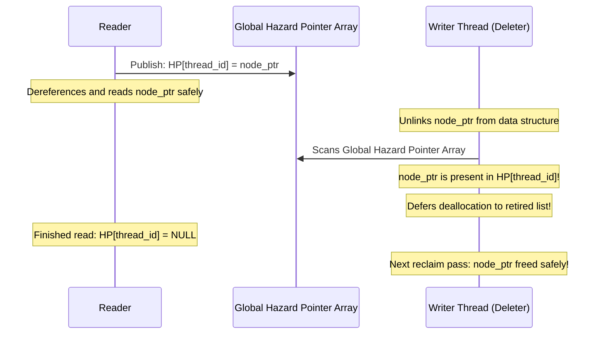

# Concurrency Internals: Hazard Pointers Architecture

Hazard Pointers provide lock-free memory reclamation by allowing reader threads to publish a list of pointers currently being accessed.

---

## 1. Bound Guarantee
The number of retired, unreclaimed nodes per thread is bounded by $O(H \times P)$ where $H$ is hazard pointers per thread and $P$ is total threads.
