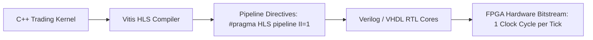

# FPGA High-Level Synthesis (HLS) for Trading Logic

High-Level Synthesis allows compiling annotated C/C++ directly into register-transfer level (RTL) Verilog pipelines.



---

## 1. Initiation Interval (II=1) Optimization

An Initiation Interval of 1 ($II=1$) guarantees that the hardware pipeline accepts a new market tick on every clock cycle without pipeline stalls:

```cpp
#include <ap_int.h>

void process_tick_stream(ap_uint<64> raw_packet, ap_uint<32>& order_signal) {
    #pragma HLS PIPELINE II=1
    #pragma HLS INTERFACE ap_ctrl_none port=return
    #pragma HLS INTERFACE axis port=raw_packet
    #pragma HLS INTERFACE axis port=order_signal

    ap_uint<32> price = raw_packet.range(31, 0);
    ap_uint<32> volume = raw_packet.range(63, 32);

    if (price < 100000 && volume > 500) {
        order_signal = 1; // Trigger aggressive buy signal
    } else {
        order_signal = 0;
    }
}
```
