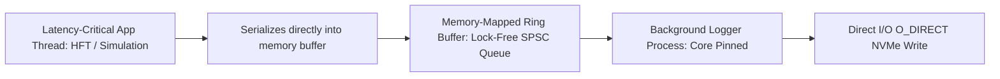

# Ultra-Low Latency: Binary Ring Buffer Logging with Google FlatBuffers

Low-latency systems replace textual formatting (`printf`, JSON) with zero-allocation binary logging, serializing structured telemetry into shared-memory circular ring buffers via Google FlatBuffers.

---

## 1. Zero-Copy Architecture

1. **Zero Heap Allocation:** FlatBuffers constructs serialized binary objects directly inside pre-allocated ring buffer slots without intermediate object allocations.
2. **Internal Offsets:** Records utilize relative vtable offsets, allowing data to be read, mapped, or persisted without deserialization or unpacking steps.
3. **Core Isolation:** Hot trading threads append records using non-blocking atomic sequence increments (`atomic_fetch_add`), leaving disk synchronization exclusively to dedicated background cores.
