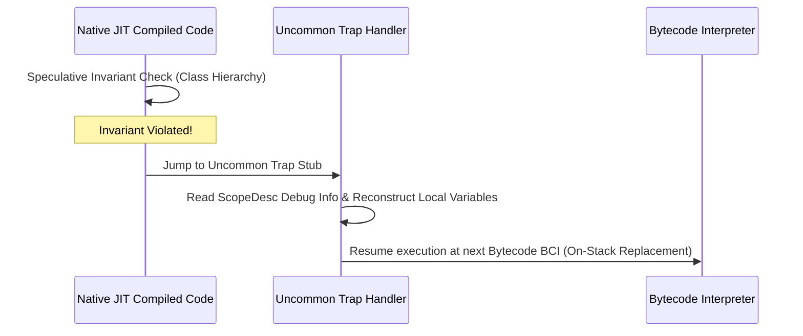

# HotSpot C2 JIT Deoptimization & On-Stack Replacement (OSR)

The HotSpot JVM compiles hot bytecode into optimized native machine code assuming speculative class invariants. When class loading invalidates an assumption, deoptimization reconstructs interpreter stack frames on the fly.

---

## 1. ScopeDesc Metadata

C2 stores debug metadata mapping machine registers and stack slots back to bytecode interpreter variables for every safepoint, permitting exact state recovery during deoptimization.
