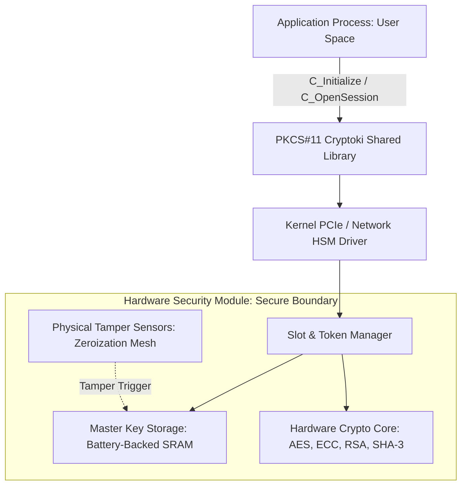

# Cryptography: PKCS#11 & Hardware Security Module (HSM) Architecture

The PKCS#11 (Cryptoki) standard specifies an abstract, platform-independent API for managing cryptographic tokens, sessions, and hardware-enforced private key lifecycles inside FIPS 140-2/3 Level 3/4 Hardware Security Modules.

---

## 1. Object Model & Security Invariants

* **`CKA_PRIVATE`:** When set to `CK_TRUE`, objects require user authentication via `C_Login(session, CKU_USER, pin)` before access.
* **`CKA_SENSITIVE` & `CKA_EXTRACTABLE`:** If `CKA_EXTRACTABLE == CK_FALSE`, the private key material can never leave the HSM boundary in plaintext.
* **Key Wrapping:** Exporting private keys between HSM clusters mandates envelope encryption using `C_WrapKey` and `C_UnwrapKey` under an asymmetric Key Encryption Key (KEK) or AES Key Wrap (RFC 3394 / RFC 5649).
* **Zeroization:** Any physical intrusion (voltage fluctuation, temperature extremes, or physical enclosure penetration) triggers active zeroization circuits, grounding battery-backed SRAM within nanoseconds.
