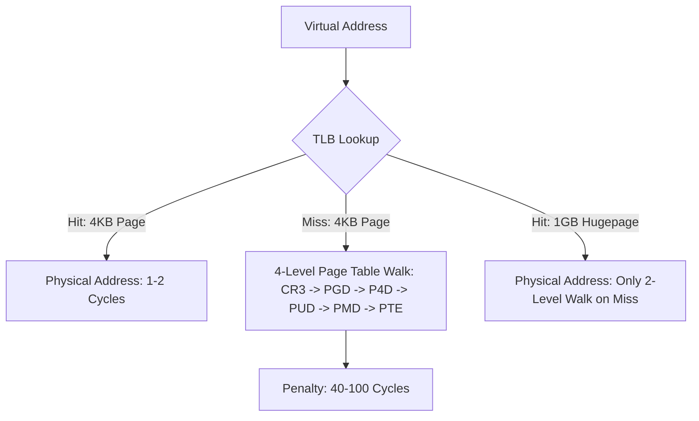

# Hugepages (2MB / 1GB) & TLB Miss Elimination

Standard 4KB memory pages require multi-level page table walks upon TLB misses. 2MB and 1GB hugepages eliminate page walk overhead for low-latency memory pools.



---

## 1. Page Size vs TLB Capacity

| Page Size | TLB Entries Needed for 16GB Working Set | TLB Miss Frequency |
|---|---|---|
| **4 KB** | 4,194,304 entries (Exceeds hardware TLB size of ~1536 entries) | Very High (Thrashing) |
| **2 MB** | 8,192 entries | Moderate |
| **1 GB** | 16 entries (Easily fits in L1 TLB) | Effectively Zero |

---

## 2. Allocating 1GB Hugepages via `mmap`

```cpp
#include <sys/mman.h>
#include <fcntl.h>
#include <unistd.h>
#include <stdexcept>

void* allocate_1gb_hugepage_pool(size_t num_gigabytes) {
    size_t total_size = num_gigabytes * 1024ULL * 1024ULL * 1024ULL;

    void* ptr = mmap(NULL, total_size,
                     PROT_READ | PROT_WRITE,
                     MAP_PRIVATE | MAP_ANONYMOUS | MAP_HUGETLB | (30 << MAP_HUGE_SHIFT),
                     -1, 0);

    if (ptr == MAP_FAILED) {
        throw std::runtime_error("1GB hugepage allocation failed");
    }

    // Lock memory into physical RAM to prevent OS swapping
    if (mlock(ptr, total_size) != 0) {
        munmap(ptr, total_size);
        throw std::runtime_error("mlock failed on hugepage pool");
    }

    return ptr;
}
```
