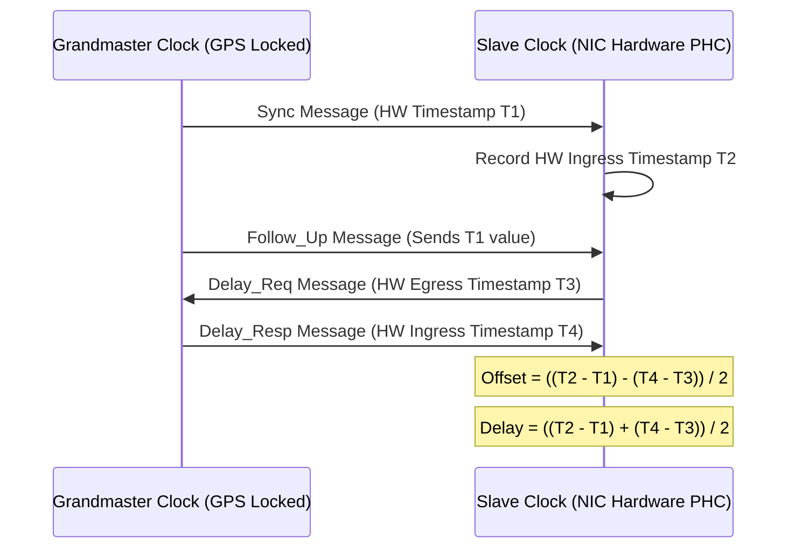

# IEEE 1588 Precision Time Protocol (PTP) & Hardware Timestamping

IEEE 1588 PTP achieves sub-nanosecond clock synchronization across distributed nodes by capturing packet transit timestamps directly in the physical layer (PHY) transceiver hardware.



---

## 1. Socket Configuration Flags

```c
// Enable hardware timestamping on socket
int flags = SOF_TIMESTAMPING_TX_HARDWARE |
            SOF_TIMESTAMPING_RX_HARDWARE |
            SOF_TIMESTAMPING_RAW_HARDWARE;
setsockopt(fd, SOL_SOCKET, SO_TIMESTAMPING, &flags, sizeof(flags));
```
