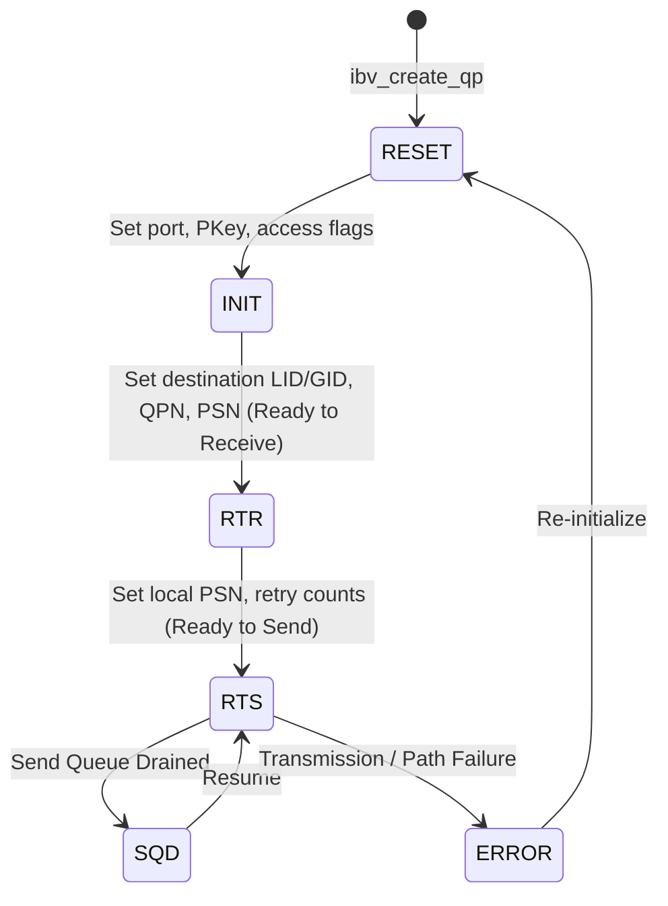

# InfiniBand Verbs Queue Pair (QP) State Machine Architecture

InfiniBand and RoCE communicate using Queue Pairs (Send Queue + Receive Queue). Transitions follow a strict hardware-enforced lifecycle managed through the `ibv_modify_qp` verbs system interface.

---

## 1. Queue Pair Types

| Transport Type | Connection Mode | Reliability | Operations Supported |
|---|---|---|---|
| **RC (Reliable Connection)** | 1-to-1 Dedicated Pair | Hardware ACK/NACK | RDMA Read, Write, Atomic, Send/Receive |
| **UC (Unreliable Connection)** | 1-to-1 Dedicated Pair | No retransmission | RDMA Write, Send/Receive |
| **UD (Unreliable Datagram)** | 1-to-Many Multicast | Best effort | Send/Receive only (MTU bounded) |
