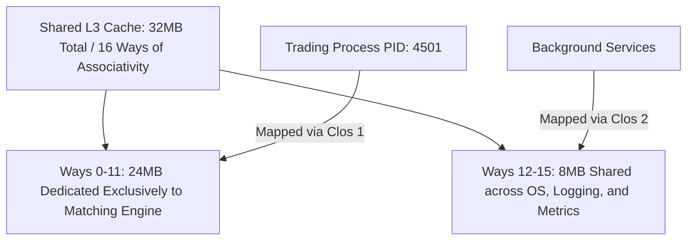

# Intel CAT (Cache Allocation Technology) Partitioning

Intel RDT and Cache Allocation Technology (CAT) partition the shared L3 (Last-Level Cache) to shield latency-sensitive trading processes from cache thrashing.



---

## 1. Class of Service (CLOS) Bitmask Allocation

Intel CAT divides L3 cache ways into bitmasks assigned to Classes of Service (CLOS):

```bash
# Verify CAT support on processor
sudo pqos -d

# Allocate ways 0-11 (bitmask 0x0FFF) to Class 1 (Trading)
# Allocate ways 12-15 (bitmask 0xF000) to Class 2 (General OS)
sudo pqos -e "llc:1=0x0FFF;llc:2=0xF000"

# Assign matching engine process (PID 4501) to Class 1
sudo pqos -a "core:1=4501"
```

---

## 2. Benefits for Tail Latency

By preventing non-critical processes (log flushers, network metric collectors) from evicting order book data structures from L3, Intel CAT eliminates p99.9 latency spikes caused by DRAM cache-miss roundtrips (60–80 ns per miss).
