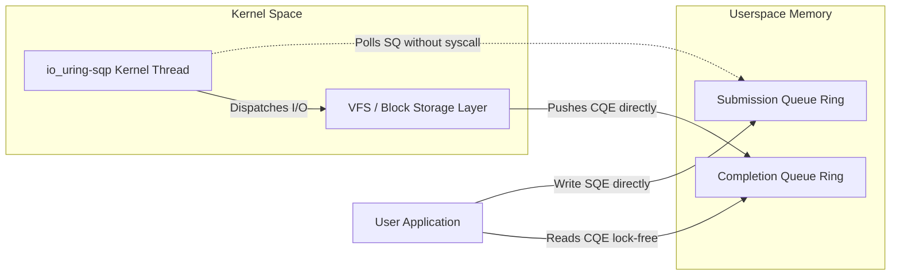

# io_uring SQPOLL: Zero-Syscall Asynchronous I/O Architecture

Linux `io_uring` with `IORING_SETUP_SQPOLL` offloads system calls to a dedicated kernel thread that continuously polls the Submission Queue (SQ), eliminating user-to-kernel context switch latency entirely during sustained I/O workloads.

---

## 1. Ring Buffer Anatomy

* **Submission Queue Entry (SQE):** 64-byte descriptor defining opcode (`IORING_OP_READV`, `IORING_OP_WRITEV`), file descriptor, buffer address, and user metadata.
* **Completion Queue Entry (CQE):** 16-byte descriptor containing return status code, transfer length, and user data identifier.
* **Memory Mapping:** Both rings share identical page mappings between userspace and kernel, allowing concurrent read/write with atomic memory barriers (`smp_load_acquire` and `smp_store_release`).
