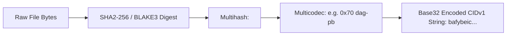

# Decentralized Web: IPFS CIDv1 Architecture

A Content Identifier (CID) is a self-describing cryptographic content address that incorporates codec, hashing algorithm, and digest length.

---

## 1. Future-Proof Addressing
If SHA-256 is deprecated in the future, CIDs seamlessly transition to post-quantum hashes without breaking addressing contracts.
