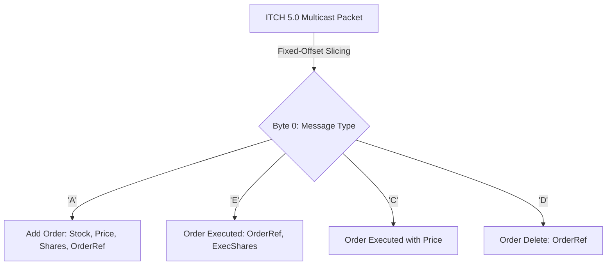

# NASDAQ ITCH & OUCH Binary Protocols

NASDAQ ITCH provides direct binary market data feeds, while OUCH provides order entry protocols optimized for low serialization overhead.



---

## 1. ITCH 5.0 Packet Structure (Add Order 'A')

All fields are packed in big-endian network byte order with fixed offsets:

```cpp
#include <cstdint>

#pragma pack(push, 1)
struct ItchAddOrderMsg {
    char message_type;            // 'A'
    uint16_t stock_locate;        // Locate code identifying instrument
    uint16_t tracking_number;     // Tracking sequence
    uint64_t timestamp_nanos;     // Nanoseconds since midnight (48-bit integer)
    uint64_t order_reference_num; // Unique order ID
    char buy_sell_indicator;      // 'B' or 'S'
    uint32_t shares;              // Number of shares
    char stock_symbol[8];         // Stock symbol right-padded with spaces
    uint32_t price;               // Fixed-point price (multiply by 10^-4)
};
#pragma pack(pop)
static_assert(sizeof(ItchAddOrderMsg) == 36, "ITCH Add Order must be exactly 36 bytes");
```

---

## 2. In-Place Decoding with Big-Endian Conversion

```cpp
#include <byteswap.h>

void process_itch_add(const uint8_t* raw_bytes) {
    const auto* msg = reinterpret_cast<const ItchAddOrderMsg*>(raw_bytes);
    
    uint64_t order_id = bswap_64(msg->order_reference_num);
    uint32_t shares = bswap_32(msg->shares);
    uint32_t raw_price = bswap_32(msg->price);
    
    double real_price = raw_price / 10000.0;
    // Dispatch directly to local order book
}
```
