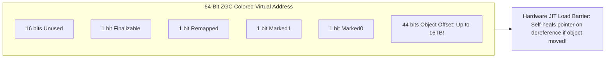

# Java Runtime: ZGC Colored Pointers and Load Barriers

ZGC delivers predictable $<1\text{ms}$ max pause times regardless of heap size (from 16MB to 16TB) using 64-bit colored pointers and concurrent compaction.

---

## 1. Load Barrier Self-Healing
If a thread dereferences an object that was relocated during concurrent compaction, the load barrier intercepts the load, reads the relocation table, updates the pointer in-place, and returns the live object.
