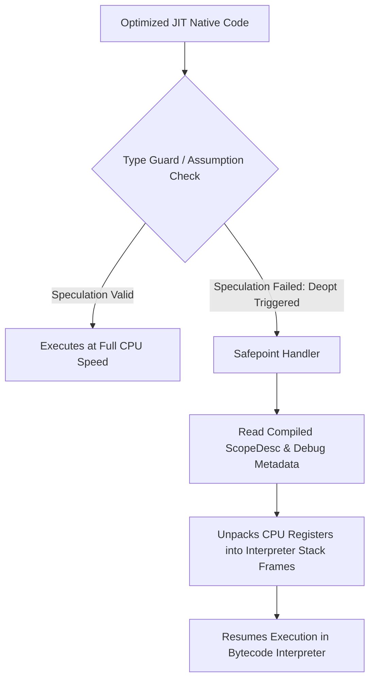

# JIT Compilation: Speculative Deoptimization & Safepoint Polls

Modern JIT compilers speculate aggressively on dynamic invariants. When a speculation is invalidated (e.g., class hierarchy changes, unexpected types), the runtime triggers Deoptimization to bail out to the interpreter.

---

## 1. Deoptimization Types

* **Eager Deoptimization:** Explicit guard instruction fails within compiled code (e.g., class check `assert(obj.class == ExpectedClass)` fails).
* **Lazy Deoptimization:** Runtime invalidates compiled code out-of-line (e.g., loading a new class introduces a method override, invalidating monomorphic inlining across existing threads).
* **Safepoint Polls:** Compilers insert safepoint checks at loop backedges and method exits; threads trap into the runtime when safepoint memory pages are unmapped by the engine.
